# codyssey-aws-web-deploy — 내가 만든 웹사이트를 인터넷에 올리기 (B3-1)

AWS 서울 리전(ap-northeast-2)에 **VPC로 격리된 네트워크를 직접 설계**하고, 그 안의 EC2에
Nginx를 배포해 **누구나 인터넷으로 접속할 수 있는 웹 서비스**를 만든 실습입니다.
보안 그룹과 IAM에는 최소권한 원칙을 적용했고, 검증이 끝난 뒤 리소스를 모두 삭제했습니다.

---

## 1. 과제 소개

### 미션

> "일단 서버에 올렸는데 외부에서 안 들어와요."

클라우드는 단순히 빠른 컴퓨터가 아니라 **네트워크, 보안, IAM이 묶인 환경**입니다.
이 과제는 네트워크(VPC)부터 직접 설계해 웹 서비스를 외부에 공개하는 것이 목표입니다.
접근 제어(Security Group)와 권한(IAM)을 최소한으로 설정하고, 오류가 나면 로그를 근거로 원인을 찾아 해결합니다.

### 학습 목표

1. VPC, Subnet, Route Table, Internet Gateway의 역할과 트래픽 흐름을 설명할 수 있다.
2. Security Group과 IAM의 차이를 구분하고, 최소권한 원칙을 적용할 수 있다.
3. 외부 요청이 EC2 웹 서버까지 도달하는 데 필요한 설정(라우팅, 퍼블릭 IP, 보안 그룹)을 설명할 수 있다.
4. 로그와 증상을 근거로 가설 → 검증 → 조치 순서로 트러블슈팅할 수 있다.
5. 과금이 발생하는 요인을 알고, 실습 리소스를 안전한 순서로 정리할 수 있다.

### 요구사항과 제약

| 구분 | 내용 |
| --- | --- |
| 네트워크 | VPC 1개, Public Subnet 1개, IGW 연결, Route Table에 `0.0.0.0/0 → IGW`, 인스턴스 아웃바운드 통신 가능 |
| 컴퓨트 | Public Subnet에 EC2 1대, SSH 접속, 웹 서버 실행, 내부 `curl http://localhost` → 200 |
| 보안 그룹 | HTTP(80)는 전체 허용, SSH(22)는 내 IP만, 0.0.0.0/0 전체 포트 허용 금지 |
| IAM | 실습 전용 사용자 1명, EC2/VPC/SG 범위로 권한 제한, AdministratorAccess 금지, 루트 계정 사용 금지 |
| 외부 접속 검증 | (A) 브라우저로 `http://<퍼블릭IP>` 또는 (B) `GET http://<퍼블릭IP>/health` → 200 |
| 비용 | 프리 티어 범위, 서울 리전, 실습 후 EC2·EBS·EIP·IGW·VPC 정리 |
| 제출물 | 아키텍처 다이어그램, 외부 접속 증빙, 트러블슈팅 보고서, 리소스 정리 체크리스트 |

---

## 2. 아키텍처

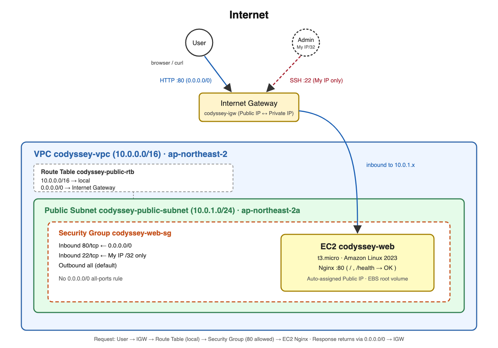

| 리소스 | 이름 | 설정 |
| --- | --- | --- |
| VPC | `codyssey-vpc` | 10.0.0.0/16 |
| Public Subnet | `codyssey-public-subnet` | 10.0.1.0/24 (ap-northeast-2a), 퍼블릭 IP 자동 할당 |
| Internet Gateway | `codyssey-igw` | VPC에 연결 |
| Route Table | `codyssey-public-rtb` | `10.0.0.0/16 → local`, `0.0.0.0/0 → IGW`, Public Subnet에 연결 |
| Security Group | `codyssey-web-sg` | 인바운드 80/tcp ← 0.0.0.0/0, 22/tcp ← 실습자 IP/32 |
| EC2 | `codyssey-web` | t3.micro, Amazon Linux 2023, EBS gp3 8GiB, Nginx |

### 외부 요청이 Nginx까지 도달하는 경로

```
사용자 브라우저
  │  HTTP GET http://<퍼블릭IP>/health
  ▼
Internet Gateway ── 퍼블릭 IP ↔ 프라이빗 IP(10.0.1.x) 변환
  ▼
Route Table      ── 들어오는 트래픽: 10.0.0.0/16 local 경로로 서브넷까지 전달
  ▼                 나가는 응답:   0.0.0.0/0 → IGW 경로로 인터넷에 반환
Security Group   ── 80/tcp가 0.0.0.0/0에 열려 있어 통과 (응답은 자동 허용)
  ▼
EC2 : Nginx(:80) ── 200 OK, "OK"
```

외부 접속이 되려면 아래 **4가지가 모두** 필요하고, 하나라도 빠지면 접속되지 않습니다.

1. **IGW가 VPC에 연결**되어 있다.
2. 서브넷 Route Table에 **`0.0.0.0/0 → IGW`** 경로가 있다. 없으면 응답이 돌아갈 길이 없다.
3. 인스턴스에 **퍼블릭 IP**가 있다. 없으면 인터넷에서 가리킬 주소가 없다.
4. Security Group이 **해당 포트(80)를 허용**한다. 없으면 패킷이 버려져 timeout이 난다.

> 서브넷이 "퍼블릭"인 이유는 이름이 아니라 Route Table의 `0.0.0.0/0 → IGW` 경로 때문입니다.

---

## 3. 실습 과정

모든 작업은 AWS CLI로 진행했습니다. 명령 전체와 단계별 확인 방법은 [실습 시나리오](docs/scenario.md)에 있고,
그대로 따라 하면 같은 환경을 다시 만들 수 있습니다.

| 단계 | 내용 | 핵심 명령 |
| --- | --- | --- |
| 0 | 작업 계정이 루트가 아닌지, 프리 티어 인스턴스 타입이 무엇인지 확인 | `sts get-caller-identity`, `describe-instance-types --filters free-tier-eligible=true` |
| 1 | 최소권한 IAM 정책·사용자 준비 | `iam create-policy`, `create-user`, `attach-user-policy` |
| 2 | VPC → Subnet → IGW → Route Table 생성 및 연결 | `create-vpc`, `create-subnet`, `attach-internet-gateway`, `create-route` |
| 3 | Security Group 생성 (80 전체, 22 내 IP) | `create-security-group`, `authorize-security-group-ingress` |
| 4 | 키 페어 생성, EC2 실행, user-data로 Nginx와 `/health` 설치 | `create-key-pair`, `run-instances --user-data` |
| 5 | SSH 접속 후 내부 검증 | `systemctl is-active nginx`, `curl localhost`, `curl https://example.com` |
| 6 | 외부에서 접속 검증 | `curl http://<퍼블릭IP>/health`, 브라우저 접속 |
| 7 | 장애 재현: SG에서 80 차단 → 원인 분석 → 복구 | `revoke-` / `authorize-security-group-ingress` |
| 8 | 생성의 역순으로 리소스 삭제 후 재조회로 확인 | `terminate-instances` … `delete-vpc` |

`/health`는 Nginx 설정 파일 하나로 만들었습니다. 인스턴스가 부팅될 때 user-data 스크립트가 Nginx 설치와 함께 이 파일을 생성합니다.

```nginx
# /etc/nginx/default.d/health.conf
location = /health {
    default_type text/plain;
    return 200 "OK\n";
}
```

---

## 4. 검증 결과

### 외부 접속 — 방식 (B) 선택

- **선택한 방식:** (B) `GET http://<퍼블릭IP>/health` 호출 → 200과 고정 문구 `OK` 확인
- **접속 정보:** `http://13.125.53.24/health` (실습 당시 퍼블릭 IP. 리소스 삭제 후 반납되어 지금은 접속되지 않음)

```
$ curl -i http://13.125.53.24/health
HTTP/1.1 200 OK
Server: nginx/1.30.6
Content-Type: text/plain
Content-Length: 3

OK
```

**`/health` 접속 화면 (B)**

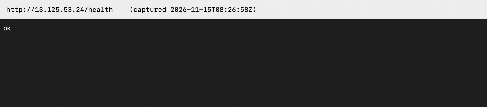

**기본 페이지 접속 화면 (A)**

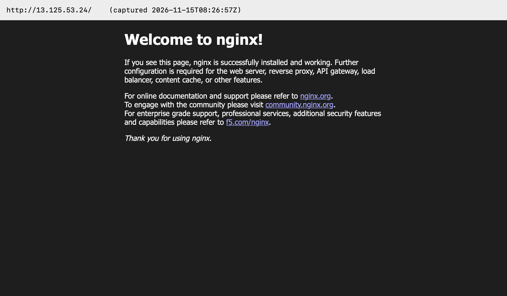

> 외부(실습자 PC)에서 퍼블릭 IP로 접속해 캡처했습니다. 상단 바에 URL과 캡처 시각(UTC)이 함께 찍혀 있습니다.

### 평가 항목별 결과 요약

| 평가 항목 | 결과 | 실행 화면 |
| --- | :---: | --- |
| 결과물 1. 아키텍처 다이어그램 | ✅ | [2장](#2-아키텍처) |
| 결과물 2. 외부 접속 증빙 (방식 B) | ✅ 200 `OK` | [위 화면](#외부-접속--방식-b-선택), [화면 5](#화면-5-외부-접속-검증) |
| 결과물 3. 트러블슈팅 보고서 | ✅ 3건 | [화면 7](#화면-7-트러블슈팅-재현) |
| 결과물 4. 리소스 정리 체크리스트 | ✅ | [화면 6](#화면-6-운영-안정성과금-방지) |
| 기능 1. 네트워크 구성 (VPC·Subnet·IGW·Route, 아웃바운드) | ✅ | [화면 1](#화면-1-네트워크-구성), [화면 2](#화면-2-컴퓨트-및-웹-서버) |
| 기능 2. 컴퓨트·웹 서버 (EC2, SSH, Nginx, localhost 200) | ✅ | [화면 2](#화면-2-컴퓨트-및-웹-서버) |
| 기능 3. 보안 그룹 (80 전체, 22 내 IP, 전체 포트 허용 없음) | ✅ | [화면 3](#화면-3-접근-제어보안-그룹) |
| 기능 4. IAM 최소권한 (AdministratorAccess 없음, S3·RDS 거부) | ✅ | [화면 4](#화면-4-iam-최소권한) |
| 기능 5. 외부 접속 검증 (택 1: B) | ✅ | [화면 5](#화면-5-외부-접속-검증) |
| 기능 6. 운영 안정성 (EC2·EBS·EIP·IGW·VPC 정리) | ✅ | [화면 6](#화면-6-운영-안정성과금-방지) |

### 평가 항목별 실행 스크린샷

> 아래 터미널 화면은 2026-11-15 실습 중 저장한 **실제 실행 로그**(`screenshots/*.txt`)를 터미널 모양으로 렌더링한 것입니다.
> 계정 ID는 `<ACCT>`로, 실습자 IP의 마지막 자리는 `x`로 가렸습니다.

#### 화면 1. 네트워크 구성

Route Table에 `0.0.0.0/0 → igw-…` 경로가 `active`이고, 이 Route Table이 Public Subnet에 연결되어 있습니다. IGW는 VPC에 `available` 상태로 붙어 있습니다.

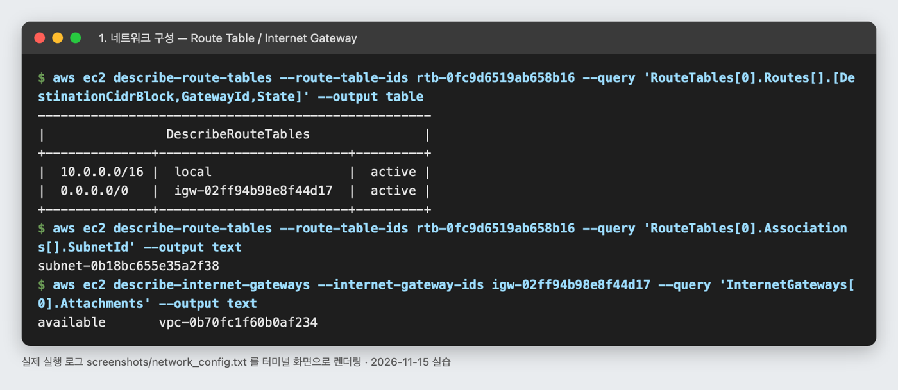

#### 화면 2. 컴퓨트 및 웹 서버

SSH로 `ec2-user` 접속 → Nginx `active` → `curl http://localhost` **200** → 아웃바운드 `curl https://example.com` **200** 순서로 확인했습니다.

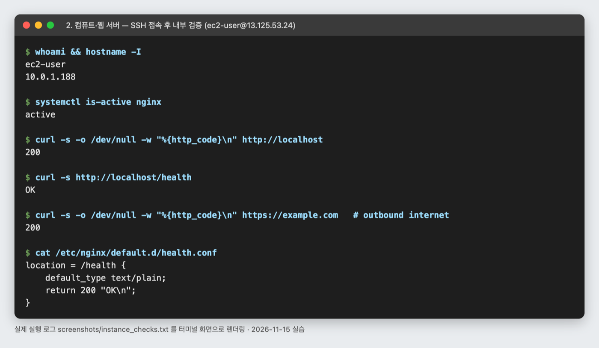

#### 화면 3. 접근 제어(보안 그룹)

인바운드 규칙은 `80 ← 0.0.0.0/0`, `22 ← 실습자 IP/32` 두 개뿐이고, 전체 포트를 여는 규칙은 없습니다.

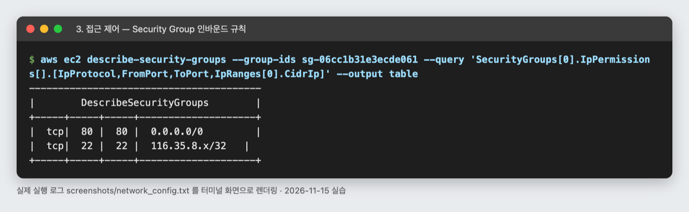

#### 화면 4. IAM 최소권한

실습 사용자 `codyssey-mission2`에는 커스텀 정책 `codyssey-ec2-lab`만 붙어 있습니다. S3·IAM·RDS 호출과 다른 리전(us-east-1)의 EC2 호출은 거부되고, 서울 리전 EC2 조회만 성공합니다.

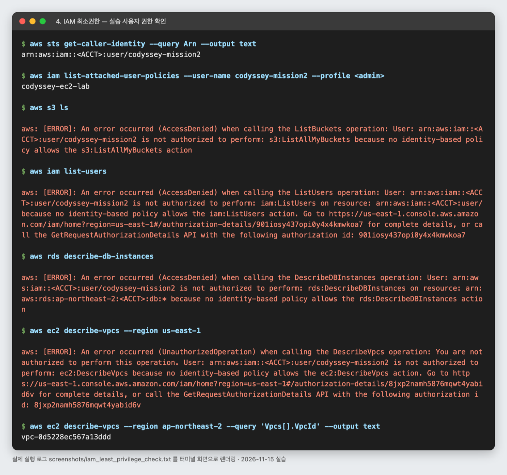

#### 화면 5. 외부 접속 검증

실습자 PC(VPC 바깥)에서 퍼블릭 IP로 `/health`를 호출하면 `HTTP/1.1 200 OK`와 `OK`가 돌아옵니다. 브라우저 화면은 위에 있습니다.

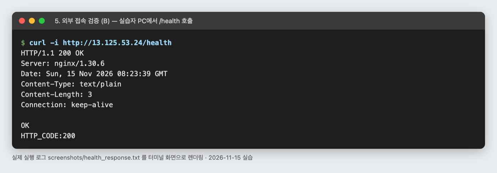

#### 화면 6. 운영 안정성(과금 방지)

모든 리소스를 지운 뒤 다시 조회했습니다. EC2는 `terminated`, EBS·IGW·VPC·키 페어는 `NotFound`, Elastic IP·NAT Gateway는 0건이고, 남은 VPC는 AWS 기본 VPC뿐입니다.

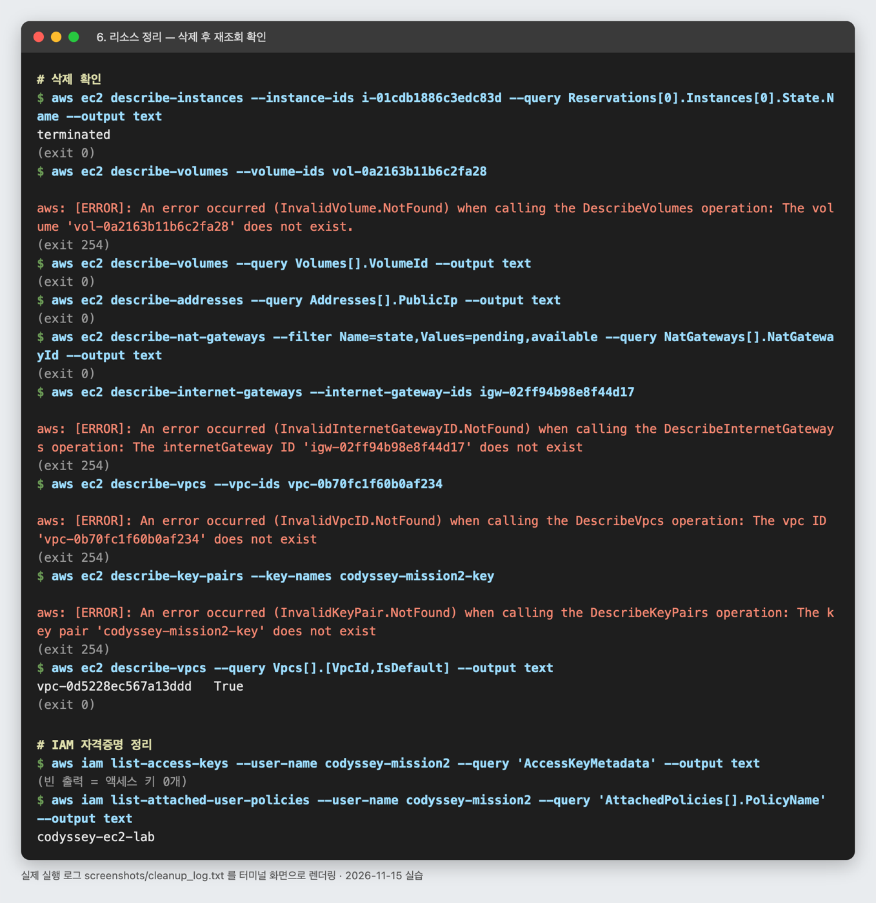

청구서 화면 (2026년 11월, 예상 총합계 USD 0.00, 계정 ID 가림):

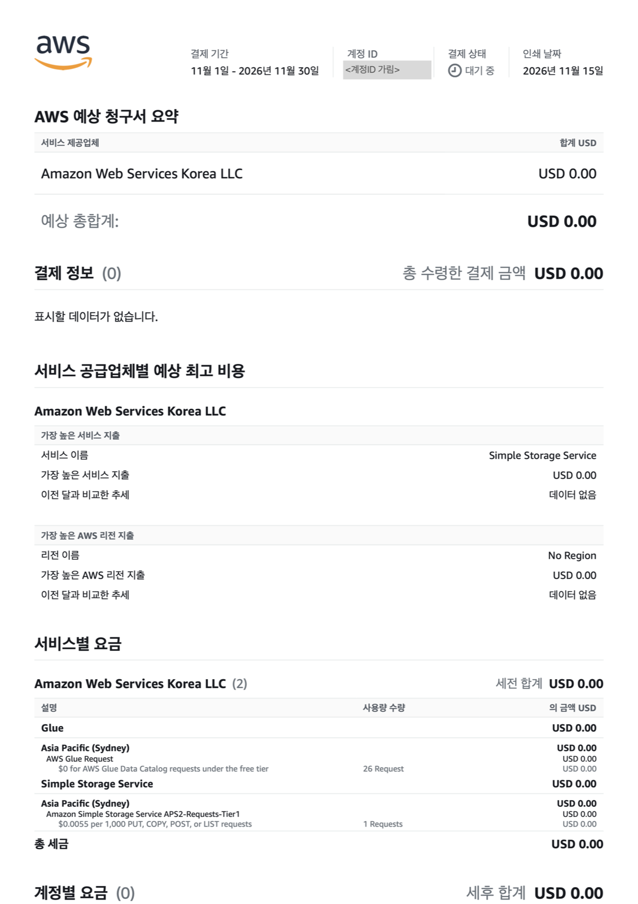

#### 화면 7. 트러블슈팅 재현

SG에서 80 규칙을 지우자 외부 요청이 timeout 났습니다. 서버 내부는 정상이고, 같은 서버의 빈 포트는 `refused`가 났습니다. 80 규칙을 복구하자 다시 200이 돌아왔습니다. (6장, [troubleshooting.md](docs/troubleshooting.md) 이슈 3)

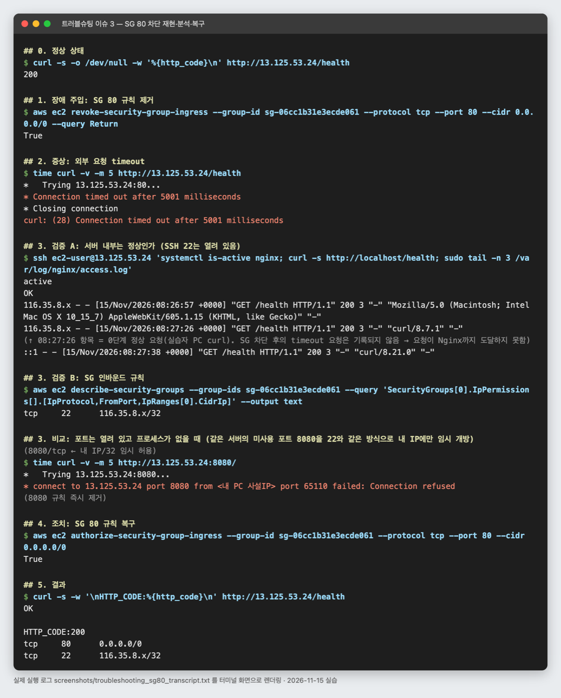

---

## 5. 보안 설계: Security Group과 IAM

두 장치는 지키는 대상이 다릅니다.

| | Security Group | IAM |
| --- | --- | --- |
| 막는 대상 | **네트워크 트래픽** (누가 어떤 포트로 인스턴스에 들어올 수 있나) | **AWS API 호출** (누가 어떤 리소스를 만들고 지울 수 있나) |
| 적용 위치 | 인스턴스(네트워크 인터페이스) 단위 | 사용자·역할 단위 |
| 이번 설정 | 80만 전체 공개, 22는 내 IP/32만 허용 | 실습에 쓰는 EC2 API만, 서울 리전에서만 허용 |
| 뚫렸을 때 피해 | 서버 침입 (예: 22 전체 공개 시 무차별 대입 공격) | 계정 전체 탈취, 과금 폭탄 |

### Security Group 규칙

| 방향 | 포트 | 소스 | 이유 |
| --- | --- | --- | --- |
| Inbound | 80/tcp | 0.0.0.0/0 | 누구나 웹 서비스를 쓸 수 있어야 함 |
| Inbound | 22/tcp | 실습자 IP/32 | 관리용 포트라 나만 접근 |
| Outbound | 전체 | 0.0.0.0/0 | 기본값 (패키지 설치, 외부 통신) |

> 아웃바운드는 SG 기본값(전체 허용)을 그대로 두었습니다. 과제의 제한 대상은 인바운드이고, 패키지 설치(`dnf`)와 아웃바운드 검증(`curl https://example.com`)에 HTTP/HTTPS가 필요하기 때문입니다.
> 더 좁히려면 아웃바운드를 `80, 443/tcp`로만 열 수 있습니다. 이때도 SG는 Stateful이라 인바운드 요청의 응답은 영향을 받지 않습니다.

### IAM 최소권한

- 리소스 작업은 루트 계정이 아닌 IAM 사용자 `codyssey-mission2`로만 했습니다.
- **제약과 다른 점:** 과제는 루트 계정 사용을 예외 없이 금지하지만, 이 실습에서는 루트 계정을 두 번 썼습니다. 실습용 IAM 사용자·정책을 만드는 부트스트랩과 청구서 확인입니다. 둘 다 리소스 작업은 아니지만 제약을 그대로 지킨 것은 아니므로 **편차로 기록**합니다. 루트 액세스 키는 실습 후 삭제했습니다. ([트러블슈팅 이슈 2](docs/troubleshooting.md))
  - 제약을 지키려면 루트로 관리용 IAM 사용자를 한 번만 만들고, 이후 IAM 사용자 생성과 청구서 확인(계정 설정에서 IAM 사용자의 결제 정보 접근 허용)까지 그 사용자로 해야 합니다.
- 이 사용자에게는 커스텀 정책 `codyssey-ec2-lab` 하나만 붙였습니다. ([정책 원문](iam/codyssey-ec2-lab-policy.json))
  - `ec2:Describe*`와 실습에 필요한 생성·삭제·연결·태그 API만 나열했습니다.
  - `aws:RequestedRegion = ap-northeast-2` 조건으로 서울 리전에서만 동작합니다.
  - AdministratorAccess는 없고, 관리형 정책 `AmazonEC2FullAccess`도 쓰지 않았습니다. 이 정책에는 실습에 필요 없는 ELB·Auto Scaling·CloudWatch 권한이 들어 있습니다.
  - `Resource`는 `"*"`입니다. `Create*`·`RunInstances` 같은 생성 API는 만들기 전에는 리소스 ARN이 없어서 특정 리소스로 좁히기 어렵기 때문입니다. 대신 **행동(Action) 목록과 리전 조건**으로 범위를 줄였습니다. 더 좁히려면 `Project=codyssey` 태그 조건(`aws:RequestTag`, `aws:ResourceTag`)을 붙일 수 있습니다.
- 무관한 서비스와 다른 리전 호출이 실제로 거부되는지 확인했습니다.

```
$ aws s3 ls
AccessDenied ... not authorized to perform: s3:ListAllMyBuckets
$ aws iam list-users
AccessDenied ... not authorized to perform: iam:ListUsers
$ aws rds describe-db-instances
AccessDenied ... not authorized to perform: rds:DescribeDBInstances
$ aws ec2 describe-vpcs --region us-east-1
UnauthorizedOperation ... not authorized to perform: ec2:DescribeVpcs
$ aws ec2 describe-vpcs --region ap-northeast-2 --query 'Vpcs[].VpcId' --output text
vpc-0d5228ec567a13ddd          ← 서울 리전 조회는 허용
```

---

## 6. 트러블슈팅

각 이슈의 증상 → 가설 → 검증 → 조치 → 결과 → 재발방지는 [docs/troubleshooting.md](docs/troubleshooting.md)에 있습니다.

| # | 증상 | 원인 | 조치 |
| --- | --- | --- | --- |
| 1 | `t2.micro` 생성 시 `not eligible for Free Tier` 오류 | 이 계정은 t3/t4g 계열이 프리 티어 대상 | 프리 티어 대상 타입을 조회한 뒤 `t3.micro`로 변경 |
| 2 | `sts get-caller-identity`의 Arn이 `:root` | CLI에 루트 계정 액세스 키가 등록됨 | 최소권한 IAM 사용자를 만들어 전환 |
| 3 | 서버는 정상인데 외부 요청이 **timeout** | Security Group에 80 인바운드 규칙 없음 | 원인을 좁힌 뒤 80 규칙 복구 → 200 |

**이슈 3** — 미션의 "서버에 올렸는데 외부에서 안 들어와요" 상황을 직접 재현했습니다.
- 서버 안에서는 Nginx가 정상 응답했고, Nginx 접속 로그에는 timeout된 요청이 남지 않았습니다. 요청이 서버까지 오지 못했다는 뜻입니다.
- 같은 서버의 빈 포트(8080)를 잠깐 열어 요청하면 timeout이 아니라 즉시 `Connection refused`가 납니다.
- 이 테스트에서는 **timeout이 SG의 80 인바운드 규칙 누락으로 발생**했고, 프로세스가 없는 빈 포트는 **refused**를 반환했습니다. ([원문 로그](screenshots/troubleshooting_sg80_transcript.txt))
- 일반적으로 timeout은 SG·NACL·라우팅을, refused는 서버 프로세스를 먼저 의심하는 **출발점**입니다. 호스트 방화벽이 거절하면 프로세스가 떠 있어도 refused가 날 수 있고, 서버 과부하로도 timeout이 날 수 있으므로 원인은 따로 검증해서 확정해야 합니다.

---

## 7. 리소스 정리

리소스는 **생성의 역순**으로 지워야 합니다. 인스턴스가 살아 있으면 SG가, IGW가 붙어 있으면 VPC가 삭제되지 않습니다.

```
EC2 종료(EBS 자동 삭제) → SG → Route Table → IGW 분리·삭제 → Subnet → VPC → 키 페어 → 실습용 액세스 키
```

| 정리 대상 | 자체 과금 | 결과 |
| --- | :---: | --- |
| EC2 | 있음 (실행 시간) | `terminated` |
| EBS | 있음 (용량) | 루트 볼륨 재조회 시 `InvalidVolume.NotFound`, 리전 전체 0개 |
| 퍼블릭 IPv4 / Elastic IP | 있음 (시간당) | 자동 할당 IP는 인스턴스와 함께 반납, Elastic IP는 할당하지 않음 (0건) |
| NAT Gateway / ELB / RDS | 있음 | 생성하지 않음 |
| Internet Gateway / VPC / Subnet / Route Table / SG | 없음 | 재조회 시 `InvalidInternetGatewayID.NotFound` / `InvalidVpcID.NotFound` |
| 키 페어, 실습용 액세스 키 | 없음 (보안상 정리) | 삭제 |
| 청구서 (2026년 11월) | - | 예상 총합계 **USD 0.00** ([billing.png](screenshots/billing.png), 계정 ID 가림) |

> VPC·Subnet·Route Table·IGW·SG는 그 자체로는 요금이 없지만, 과제 요구사항에 따라 남김없이 삭제했습니다.
> 남겨 두면 다음 실습 때 이름·대역이 겹치거나, 잊힌 규칙이 보안 구멍이 될 수 있습니다.

삭제는 명령 성공만 보고 끝내지 않고, **다시 조회해서 "없음"이 나오는지까지** 확인했습니다.
체크리스트는 [docs/cleanup-checklist.md](docs/cleanup-checklist.md)에 있습니다.

> 과금의 대표 원인은 켜져 있는 인스턴스, 남은 EBS 볼륨·스냅샷, 연결되지 않은 Elastic IP, NAT Gateway, 로드밸런서입니다.
> 인스턴스만 끄고 볼륨이나 Elastic IP를 남겨 과금되는 경우가 가장 흔합니다.

---

## 8. 저장소 구성

```
README.md                                        과제와 실습 설명 (이 문서)
docs/architecture.png  (.svg 원본)               아키텍처 다이어그램
docs/scenario.md                                 실습 시나리오 (단계별 명령 + 확인 방법)
docs/troubleshooting.md                          트러블슈팅 보고서 (3건)
docs/cleanup-checklist.md                        리소스 정리 체크리스트
docs/WORK_REPORT.md                              작업 설명문
iam/codyssey-ec2-lab-policy.json                 최소권한 IAM 정책
screenshots/browser_health.png, browser_index.png  외부 접속 스크린샷
screenshots/term_*.png                           평가 항목별 실행 화면 (아래 로그를 렌더링)
screenshots/health_response.txt 외               외부 접속 응답 원문 (curl)
screenshots/instance_checks.txt                  인스턴스 내부 검증 (SSH)
screenshots/network_config.txt                   Route Table / IGW / SG 조회 결과
screenshots/iam_least_privilege_check.txt        IAM 거부 확인 로그
screenshots/troubleshooting_sg80_transcript.txt  트러블슈팅 이슈 3 원문 로그
screenshots/cleanup_log.txt                      리소스 정리 실행·확인 로그
screenshots/billing.png                          청구서 화면
```

> 실습은 두 번 진행했습니다(2026-09-14, 2026-11-15). 이 문서의 IP, 리소스 ID, 증빙은 두 번째 실습 기준입니다.
